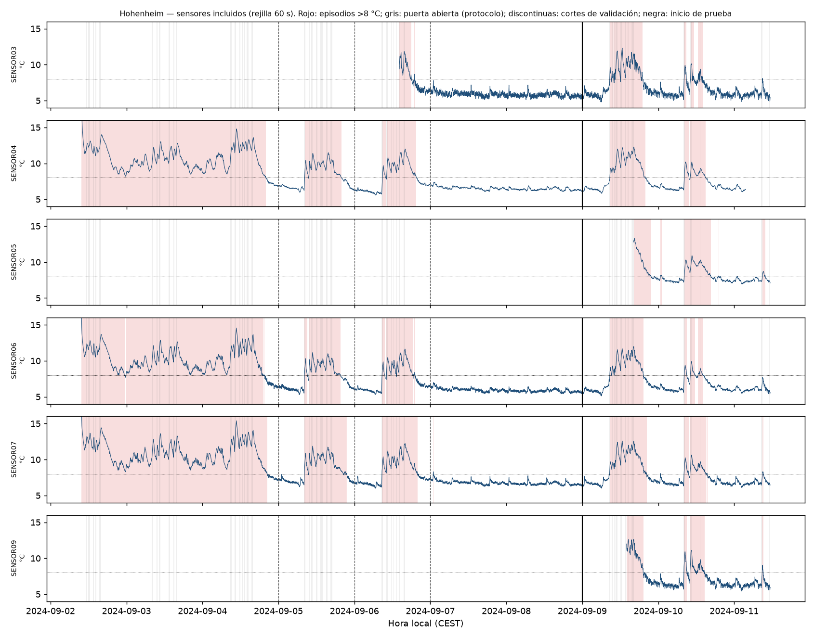
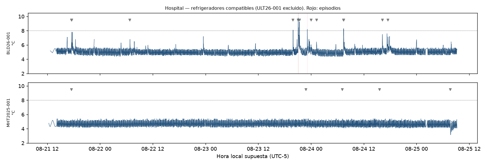

# Auditoría de datasets (generado)
> Archivo generado por `python -m src.infrastructure.ai.prediccion_preventiva auditar`. No editar a mano: la versión comentada está en `01_DATASET_AUDIT.md`. Generado: 2026-10-21T16:13:06.895554+00:00.
## Archivos de entrada y hashes SHA-256
| archivo | fuente | bytes | sha256 |
|---|---|---|---|
| Raw.zip | hohenheim | 5056109 | 3590d19a2002cb473061af9ffbffacd7036e962b0f79b86d237590a74f0ec324 |
| Preprocessed.zip | hohenheim | 5819018 | 0b25c63ea246063991b6a1e7422b50ca1f8ae4abc77450190aa964135811d55d |
| overview.csv | hohenheim | 73881 | faeeaa33ffc5cd0771a9c5218c4c8ab478cec90895627f9ca2b28cfcf34ca173 |
| experiment_actions.csv | hohenheim | 5362 | 8ac92d6c4c628233aa083ef53cdf86e30275ec73d01670ca342922c5dc8b4f2e |
| DataPreprocessing.ipynb | hohenheim | 11978 | 933057fb881862f3bb9cf9274986c4f1b4db154ffee77abc90bc8ec0133a5d93 |
| bio_data_10mindata_4d.csv | hospital | 2807187 | 0685420043e661e12292fd00157279a84362fe5829d1475f66ad7fea25605124 |

## Configuración
```json
{
  "horizonte_min": 30,
  "paso_rejilla_s": 60,
  "agregacion_s": 90,
  "ventanas_min": [
    5,
    10,
    15
  ],
  "hueco_max_s": 180,
  "cobertura_min_ventana": 0.8,
  "cobertura_min_horizonte": 0.9,
  "fusion_episodios_min": 10,
  "rango_min_c": 2.0,
  "rango_max_c": 8.0
}
```

## Hohenheim
- Título: Temperature and Humidity Time Series of Cold Storage Room Monitoring
- Autores: Henrichs, E.; Stoll, F.; Krupitzer, C. (University of Hohenheim)
- DOI: 10.5281/zenodo.15130001
- Licencia: Creative Commons Attribution 4.0 International (CC BY 4.0)
- Publicado: 2025-04-03 (v1)
- Sensor: DHT22 (9 unidades) en registradores Arduino, muestreo 5 s
- Esquema: CSV ';' sin zona horaria: Date (dd.mm.yyyy); Time (HH:MM:SS); Temperature (C); Humidity (%). Cabecera repetida en cada reinicio del registrador.
- Zona horaria: Supuesta CEST (UTC+2) para datos y acciones; convertida a UTC.

### Importación

```json
{
  "fuente": "hohenheim",
  "archivos": {
    "SENSOR01.CSV": 156019,
    "SENSOR02.CSV": 156980,
    "SENSOR03.CSV": 84450,
    "SENSOR04.CSV": 151248,
    "SENSOR05.CSV": 31146,
    "SENSOR06.CSV": 156887,
    "SENSOR07.CSV": 156885,
    "SENSOR08.CSV": 156863,
    "SENSOR09.CSV": 32717
  },
  "filas_leidas": 1083195,
  "filas_validas": 1083195,
  "descartes": {
    "cabecera_repetida": 4
  },
  "advertencias": []
}
```

### Perfil por serie

| serie | registros | temperaturas_validas | inicio_utc | fin_utc | duracion_h | intervalo_mediana_s | huecos_mayores_hueco_max | hueco_max_s | timestamps_duplicados | temp_min | temp_mediana | temp_max | pct_en_rango | pct_sobre_max | pct_bajo_min | clase_equipo |
|---|---|---|---|---|---|---|---|---|---|---|---|---|---|---|---|---|
| SENSOR01 | 155719 | 155719 | 2024-09-02T07:45:00+00:00 | 2024-09-11T09:22:00+00:00 | 217.620 | 5.000 | 1 | 4835.000 | 0 | 5.300 | 9.400 | 42.200 | 39.990 | 60.010 | 0.000 | refrigeracion_compatible |
| SENSOR02 | 156685 | 156685 | 2024-09-02T07:45:00+00:00 | 2024-09-11T09:22:00+00:00 | 217.620 | 5.000 | 0 | 5.000 | 0 | 5.800 | 9.300 | 38.700 | 38.860 | 61.140 | 0.000 | refrigeracion_compatible |
| SENSOR03 | 84409 | 84409 | 2024-09-06T12:08:00+00:00 | 2024-09-11T09:22:00+00:00 | 117.230 | 5.000 | 0 | 5.000 | 0 | 4.800 | 6.000 | 12.300 | 86.070 | 13.930 | 0.000 | refrigeracion_compatible |
| SENSOR04 | 151053 | 151053 | 2024-09-02T07:45:00+00:00 | 2024-09-11T01:32:40+00:00 | 209.790 | 5.000 | 0 | 5.000 | 0 | 5.600 | 7.400 | 19.700 | 53.470 | 46.530 | 0.000 | refrigeracion_compatible |
| SENSOR05 | 31066 | 31066 | 2024-09-09T14:13:15+00:00 | 2024-09-11T09:22:00+00:00 | 43.150 | 5.000 | 0 | 5.000 | 0 | 6.900 | 7.700 | 13.300 | 65.010 | 34.990 | 0.000 | refrigeracion_compatible |
| SENSOR06 | 156685 | 156685 | 2024-09-02T07:45:00+00:00 | 2024-09-11T09:22:00+00:00 | 217.620 | 5.000 | 0 | 5.000 | 0 | 5.100 | 6.700 | 17.200 | 58.290 | 41.710 | 0.000 | refrigeracion_compatible |
| SENSOR07 | 156685 | 156685 | 2024-09-02T07:45:00+00:00 | 2024-09-11T09:22:00+00:00 | 217.620 | 5.000 | 0 | 5.000 | 0 | 6.000 | 7.500 | 17.200 | 53.510 | 46.490 | 0.000 | refrigeracion_compatible |
| SENSOR08 | 156685 | 156685 | 2024-09-02T07:45:00+00:00 | 2024-09-11T09:22:00+00:00 | 217.620 | 5.000 | 0 | 5.000 | 0 | 9.000 | 10.800 | 19.300 | 0.000 | 100.000 | 0.000 | refrigeracion_compatible |
| SENSOR09 | 32665 | 32665 | 2024-09-09T12:00:00+00:00 | 2024-09-11T09:22:00+00:00 | 45.370 | 5.000 | 0 | 5.000 | 0 | 5.400 | 6.600 | 12.700 | 76.110 | 23.890 | 0.000 | refrigeracion_compatible |

### Decisiones de inclusión

| serie | incluido | motivo | detalle |
|---|---|---|---|
| SENSOR01 | no | sensor_movil_sin_registro_de_movimientos | Declarado móvil por los autores; alcanza 42.2 °C (fuera de la cámara) y el CSV de acciones no registra sus movimientos. |
| SENSOR02 | no | sensor_movil_sin_registro_de_movimientos | Declarado móvil por los autores; alcanza 38.7 °C (fuera de la cámara) y el CSV de acciones no registra sus movimientos. |
| SENSOR03 | sí | incluido |  |
| SENSOR04 | sí | incluido |  |
| SENSOR05 | sí | incluido |  |
| SENSOR06 | sí | incluido |  |
| SENSOR07 | sí | incluido |  |
| SENSOR08 | no | sin_lecturas_en_rango | Mínimo 9.0 °C: nunca dentro de 2-8 °C, no aporta instantes preventivos y su episodio permanente fundiría todos los incidentes del recinto. |
| SENSOR09 | sí | incluido |  |

### Excursiones y eventos (series incluidas)

| serie | episodios | inicio_no_observado | altas | bajas | duracion_mediana_min | duracion_max_min |
|---|---|---|---|---|---|---|
| SENSOR03 | 9 | 1 | 9 | 0 | 67.000 | 536.000 |
| SENSOR04 | 7 | 1 | 7 | 0 | 565.000 | 3496.000 |
| SENSOR05 | 5 | 1 | 5 | 0 | 56.000 | 505.000 |
| SENSOR06 | 12 | 1 | 12 | 0 | 92.500 | 2602.000 |
| SENSOR07 | 11 | 1 | 11 | 0 | 88.000 | 3522.000 |
| SENSOR09 | 6 | 1 | 6 | 0 | 38.500 | 318.000 |

- Episodios: 50 (altos 50, bajos 0; con salida de rango no observada: 6).
- Incidentes independientes con salida de rango observada (entorno físico): **10** (más 0 formados solo por arranques en caliente).
- Estados de etiqueta (H = 30 min): `{'negativo': 29502, 'fuera_de_rango': 20052, 'positivo': 1174, 'no_etiquetable_horizonte_incompleto': 180, 'en_episodio': 144}`.

## Hospital
- Título: Multi-Node IoT Dataset for Real-Time Hospital Cold-Chain Monitoring
- Autores: Lon Kan Perez, I. B. K. (Universidad Autónoma del Perú)
- DOI: 10.5281/zenodo.22101912
- Licencia: Creative Commons Attribution 4.0 International (CC BY 4.0)
- Publicado: 2026-08-25 (v1)
- Sensor: dsTemperature (por su nombre, DS18B20; no documentado en el registro)
- Esquema: CSV ',' con cabecera de 9 nombres (_id, __v, createdAt, datetime, doorStatus, dsTemperature, humidity, time_slot, username); 13 279 filas traen 3 campos más sin nombre.
- Zona horaria: Timestamps ISO 8601 con 'Z' (UTC).

### Importación

```json
{
  "fuente": "hospital",
  "archivos": {
    "bio_data_10mindata_4d.csv": 16379
  },
  "filas_leidas": 16379,
  "filas_validas": 16311,
  "descartes": {
    "dsTemperature_vacia": 68
  },
  "advertencias": [
    "13279 filas traen 12 campos con una cabecera de 9: los 3 campos finales no están nombrados en el archivo."
  ]
}
```

### Perfil por serie

| serie | registros | temperaturas_validas | inicio_utc | fin_utc | duracion_h | intervalo_mediana_s | huecos_mayores_hueco_max | hueco_max_s | timestamps_duplicados | temp_min | temp_mediana | temp_max | pct_en_rango | pct_sobre_max | pct_bajo_min | clase_equipo |
|---|---|---|---|---|---|---|---|---|---|---|---|---|---|---|---|---|
| BLD26-001 | 5448 | 5392 | 2026-08-21T17:28:03+00:00 | 2026-08-25T14:12:00+00:00 | 92.730 | 60.000 | 7 | 1800.000 | 0 | 4.400 | 5.000 | 9.900 | 99.830 | 0.170 | 0.000 | refrigeracion_compatible |
| MHT2025-001 | 5459 | 5448 | 2026-08-21T17:17:15+00:00 | 2026-08-25T14:12:01+00:00 | 92.910 | 60.000 | 10 | 1800.000 | 0 | 3.100 | 4.600 | 5.400 | 100.000 | 0.000 | 0.000 | refrigeracion_compatible |
| ULT26-001 | 5472 | 5471 | 2026-08-21T17:43:38+00:00 | 2026-08-25T14:12:00+00:00 | 92.470 | 60.000 | 5 | 2401.000 | 0 | -32.100 | -31.500 | -29.900 | 0.000 | 0.000 | 100.000 | ultracongelacion_incompatible |

### Decisiones de inclusión

| serie | incluido | motivo | detalle |
|---|---|---|---|
| BLD26-001 | sí | incluido |  |
| MHT2025-001 | sí | incluido |  |
| ULT26-001 | no | ultracongelacion_incompatible | Mediana -31.5 °C: equipo no comparable con un refrigerador de 2-8 °C; no se transforma para parecerlo. |

### Excursiones y eventos (series incluidas)

| serie | episodios | inicio_no_observado | altas | bajas | duracion_mediana_min | duracion_max_min |
|---|---|---|---|---|---|---|
| BLD26-001 | 5 | 0 | 5 | 0 | 1.000 | 6.000 |

- Episodios: 5 (altos 5, bajos 0; con salida de rango no observada: 0).
- Incidentes independientes con salida de rango observada (entorno físico): **5** (más 0 formados solo por arranques en caliente).
- Estados de etiqueta (H = 30 min): `{'negativo': 10595, 'no_etiquetable_horizonte_incompleto': 138, 'positivo': 131, 'sin_dato': 36, 'fuera_de_rango': 9, 'en_episodio': 2}`.

## Incidentes independientes de Hohenheim (hora local CEST)

| incidente_id | inicio_local | fin_local | series | tipo | pico_c | inicio_observado |
|---|---|---|---|---|---|---|
| hohenheim_camara_frigorifica#0 | 2024-09-02 09:45:00 | 2024-09-04 20:26:00 | 3 | alta | 19.700 | sí |
| hohenheim_camara_frigorifica#1 | 2024-09-05 08:12:00 | 2024-09-05 21:16:00 | 3 | alta | 11.878 | sí |
| hohenheim_camara_frigorifica#2 | 2024-09-05 21:31:00 | 2024-09-05 21:39:00 | 1 | alta | 8.111 | sí |
| hohenheim_camara_frigorifica#3 | 2024-09-06 08:42:00 | 2024-09-06 19:55:00 | 4 | alta | 12.233 | sí |
| hohenheim_camara_frigorifica#4 | 2024-09-07 00:54:00 | 2024-09-07 01:00:00 | 1 | alta | 8.311 | sí |
| hohenheim_camara_frigorifica#5 | 2024-09-09 08:38:00 | 2024-09-09 21:46:00 | 6 | alta | 13.294 | sí |
| hohenheim_camara_frigorifica#6 | 2024-09-10 00:40:00 | 2024-09-10 01:11:00 | 2 | alta | 8.200 | sí |
| hohenheim_camara_frigorifica#7 | 2024-09-10 08:07:00 | 2024-09-10 16:38:00 | 6 | alta | 11.106 | sí |
| hohenheim_camara_frigorifica#8 | 2024-09-10 19:08:00 | 2024-09-10 19:10:00 | 1 | alta | 8.100 | sí |
| hohenheim_camara_frigorifica#9 | 2024-09-11 08:51:00 | 2024-09-11 09:50:00 | 4 | alta | 9.044 | sí |

## Figuras




