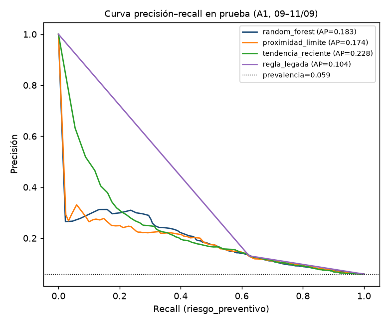
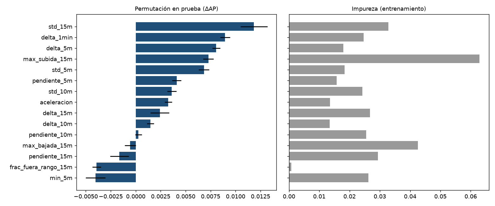
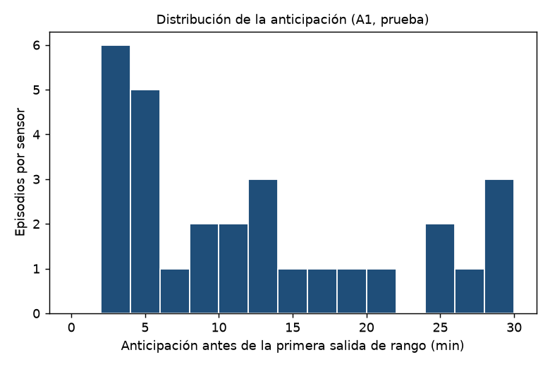
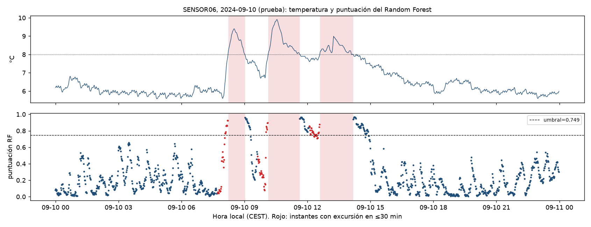
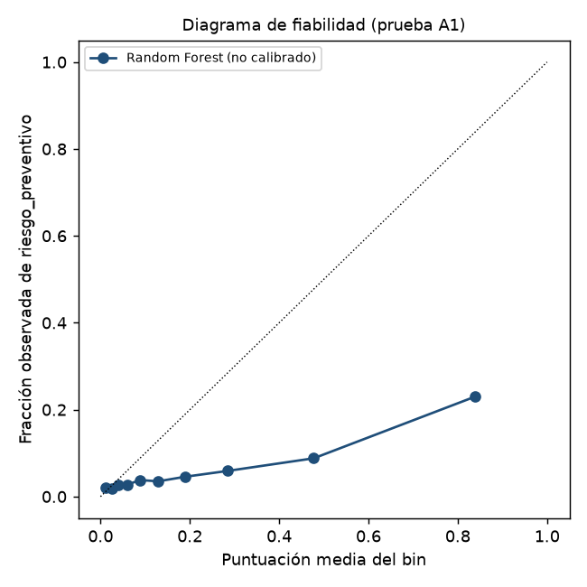
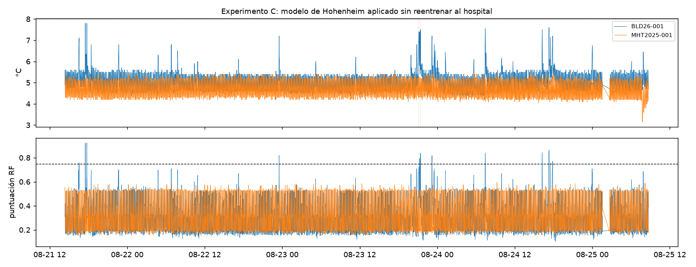

# Resultados de experimentos (generado)
> Generado por el pipeline el 2026-10-21T16:14:43.082635+00:00. Versiones: `{'python': '3.12.15', 'scikit_learn': '1.9.1', 'numpy': '2.5.4', 'pandas': '3.0.6', 'scipy': '1.18.1', 'joblib': '1.6.0', 'plataforma': 'Linux-6.18.54.1-microsoft-standard-WSL2-x86_64-with-glibc2.41'}`.

**Estado del modelo principal (A1): EXPERIMENTAL** — Incidentes independientes en prueba insuficientes para una evaluación concluyente.

## Criterios de aceptación (fijados antes de evaluar)

| criterio | valor | valor_rf | valor_baseline | mejor_baseline | umbral | cumple |
|---|---|---|---|---|---|---|
| suficiencia_incidentes | 5 | — | — | — | 10 | no |
| sensibilidad_incidente | 1.000 | — | — | — | 0.800 | sí |
| limite_inferior_ic95 | 0.478 | — | — | — | 0.500 | no |
| falsas_alarmas_por_dia_sensor | 4.735 | — | — | — | 2.000 | no |
| mediana_anticipacion_min | 11.000 | — | — | — | 5.000 | sí |
| rf_supera_mejor_baseline_ap | — | 0.183 | 0.228 | tendencia_reciente | — | no |

**Variante con puerta (A2): EXPERIMENTAL** — Incidentes independientes en prueba insuficientes para una evaluación concluyente.

| criterio | valor | valor_rf | valor_baseline | mejor_baseline | umbral | cumple |
|---|---|---|---|---|---|---|
| suficiencia_incidentes | 5 | — | — | — | 10 | no |
| sensibilidad_incidente | 1.000 | — | — | — | 0.800 | sí |
| limite_inferior_ic95 | 0.478 | — | — | — | 0.500 | no |
| falsas_alarmas_por_dia_sensor | 3.229 | — | — | — | 2.000 | no |
| mediana_anticipacion_min | 16.500 | — | — | — | 5.000 | sí |
| rf_supera_mejor_baseline_ap | — | 0.506 | 0.228 | tendencia_reciente | — | sí |

## Experimento A1: A1_hohenheim_termico_h30

- Features (28): `temp_actual, dist_limite_sup, dist_limite_inf, delta_1min, media_5m, min_5m, max_5m, std_5m, pendiente_5m, delta_5m, media_10m, min_10m, max_10m, std_10m, pendiente_10m, delta_10m, media_15m, min_15m, max_15m, std_15m, pendiente_15m, delta_15m, max_subida_15m, max_bajada_15m, frac_subidas_15m, aceleracion, frac_cerca_limite_15m, frac_fuera_rango_15m`
- Observaciones excluidas: `{'fuera_de_rango': 20052, 'no_etiquetable_horizonte_incompleto': 180, 'en_episodio': 144, 'historial_insuficiente': 0}`
- Desarrollo: 17116 obs, 384 positivas, 5 incidentes; series ['SENSOR03', 'SENSOR04', 'SENSOR06', 'SENSOR07']
- Prueba: 13380 obs, 790 positivas, 5 incidentes; series ['SENSOR03', 'SENSOR04', 'SENSOR05', 'SENSOR06', 'SENSOR07', 'SENSOR09']
- Auditoría de fugas: `{'indices_duplicados': 0, 'etiquetas_incompletas': 0, 'ventanas_solapadas_entre_particiones': 0, 'incidentes_compartidos': 0, 'transformaciones_ajustadas_con_prueba': 0}`
- Mejores hiperparámetros (AP fuera de pliegue): `{'max_depth': None, 'min_samples_leaf': 50, 'max_features': 'sqrt', 'class_weight': 'balanced_subsample'}`
- Umbral RF (validación): `{'umbral': 0.7486307937746282, 'f1': 0.24695652173913044, 'precision': 0.30869565217391304, 'recall': 0.20579710144927535}`

### Prueba independiente

| modelo | umbral | AP | ROC-AUC | precision_riesgo | recall_riesgo | F1_riesgo | macro_F1 | bal_acc | accuracy | episodios_anticipados | ep_con_5min | ep_con_10min | incidentes_anticipados | anticipacion_mediana_min | falsas_alarmas_dia_sensor |
|---|---|---|---|---|---|---|---|---|---|---|---|---|---|---|---|
| random_forest | 0.749 | 0.183 | 0.737 | 0.239 | 0.359 | 0.287 | 0.615 | 0.644 | 0.894 | 29/29 | 0.655 | 0.517 | 5/5 | 11.000 | 4.735 |
| clase_mayoritaria | 0.500 | 0.059 | 0.500 | — | 0.000 | 0.000 | 0.485 | 0.500 | 0.941 | 0/29 | 0.000 | 0.000 | 0/5 | — | 0.000 |
| proximidad_limite | -0.289 | 0.174 | 0.735 | 0.244 | 0.234 | 0.239 | 0.596 | 0.594 | 0.912 | 29/29 | 0.379 | 0.379 | 5/5 | 4.000 | 3.444 |
| tendencia_reciente | -0.340 | 0.228 | 0.731 | 0.246 | 0.305 | 0.272 | 0.610 | 0.623 | 0.904 | 29/29 | 0.759 | 0.448 | 5/5 | 7.000 | 5.596 |
| regla_legada | 0.500 | 0.104 | 0.682 | 0.131 | 0.624 | 0.216 | 0.527 | 0.682 | 0.733 | 29/29 | 0.862 | 0.724 | 5/5 | 16.000 | 4.413 |

### Validación hacia adelante (optimista para el umbral)

| modelo | AP | precision_riesgo | recall_riesgo |
|---|---|---|---|
| random_forest | 0.101 | 0.309 | 0.206 |
| proximidad_limite | 0.171 | 0.327 | 0.241 |
| tendencia_reciente | 0.167 | 0.257 | 0.270 |
| regla_legada | 0.071 | 0.112 | 0.554 |

### Estabilidad por sensor (prueba)

| serie | observaciones | positivas | average_precision | episodios_evaluables | episodios_anticipados | falsas_alarmas_por_dia_sensor |
|---|---|---|---|---|---|---|
| SENSOR03 | 2719 | 178 | 0.259 | 7 | 7 | 4.766 |
| SENSOR04 | 1988 | 81 | 0.225 | 3 | 3 | 1.449 |
| SENSOR05 | 1632 | 120 | 0.095 | 4 | 4 | 8.824 |
| SENSOR06 | 2648 | 120 | 0.147 | 4 | 4 | 3.263 |
| SENSOR07 | 2386 | 156 | 0.252 | 6 | 6 | 5.432 |
| SENSOR09 | 2007 | 135 | 0.359 | 5 | 5 | 5.740 |

### Estabilidad por día (prueba)

| dia | observaciones | positivas | average_precision | episodios_evaluables | episodios_anticipados | falsas_alarmas_por_dia_sensor |
|---|---|---|---|---|---|---|
| 2024-09-09 | 3488 | 160 | 0.163 | 6 | 6 | 4.541 |
| 2024-09-10 | 6543 | 510 | 0.248 | 19 | 19 | 4.402 |
| 2024-09-11 | 3349 | 120 | 0.053 | 4 | 4 | 5.590 |

- Subconjunto lejos del límite (T ≤ 7 °C): `{'observaciones': 9719, 'positivas': 298, 'ap_random_forest': 0.05198882629385466, 'ap_proximidad': 0.03877670824863533, 'prevalencia': 0.030661590698631547}`
- Spearman RF vs proximidad: 0.460
- IC AP por bloques: `{'average_precision_rf_bootstrap_bloques': {'valor': None, 'estado': 'no estimable', 'motivo': 'solo 3 bloques independientes (mínimo 5)'}}`

## Experimento A2: A2_hohenheim_termico_puerta_h30

- Features (30): `temp_actual, dist_limite_sup, dist_limite_inf, delta_1min, media_5m, min_5m, max_5m, std_5m, pendiente_5m, delta_5m, media_10m, min_10m, max_10m, std_10m, pendiente_10m, delta_10m, media_15m, min_15m, max_15m, std_15m, pendiente_15m, delta_15m, max_subida_15m, max_bajada_15m, frac_subidas_15m, aceleracion, frac_cerca_limite_15m, frac_fuera_rango_15m, puerta_actual, frac_puerta_15m`
- Observaciones excluidas: `{'fuera_de_rango': 20052, 'no_etiquetable_horizonte_incompleto': 180, 'en_episodio': 144, 'historial_insuficiente': 0}`
- Desarrollo: 17116 obs, 384 positivas, 5 incidentes; series ['SENSOR03', 'SENSOR04', 'SENSOR06', 'SENSOR07']
- Prueba: 13380 obs, 790 positivas, 5 incidentes; series ['SENSOR03', 'SENSOR04', 'SENSOR05', 'SENSOR06', 'SENSOR07', 'SENSOR09']
- Auditoría de fugas: `{'indices_duplicados': 0, 'etiquetas_incompletas': 0, 'ventanas_solapadas_entre_particiones': 0, 'incidentes_compartidos': 0, 'transformaciones_ajustadas_con_prueba': 0}`
- Mejores hiperparámetros (AP fuera de pliegue): `{'max_depth': 4, 'min_samples_leaf': 10, 'max_features': 0.5, 'class_weight': None}`
- Umbral RF (validación): `{'umbral': 0.2758306781939539, 'f1': 0.29237947122861585, 'precision': 0.31543624161073824, 'recall': 0.27246376811594203}`

### Prueba independiente

| modelo | umbral | AP | ROC-AUC | precision_riesgo | recall_riesgo | F1_riesgo | macro_F1 | bal_acc | accuracy | episodios_anticipados | ep_con_5min | ep_con_10min | incidentes_anticipados | anticipacion_mediana_min | falsas_alarmas_dia_sensor |
|---|---|---|---|---|---|---|---|---|---|---|---|---|---|---|---|
| random_forest | 0.276 | 0.506 | 0.812 | 0.551 | 0.443 | 0.491 | 0.731 | 0.710 | 0.946 | 28/29 | 0.862 | 0.759 | 5/5 | 16.500 | 3.229 |
| clase_mayoritaria | 0.500 | 0.059 | 0.500 | — | 0.000 | 0.000 | 0.485 | 0.500 | 0.941 | 0/29 | 0.000 | 0.000 | 0/5 | — | 0.000 |
| proximidad_limite | -0.289 | 0.174 | 0.735 | 0.244 | 0.234 | 0.239 | 0.596 | 0.594 | 0.912 | 29/29 | 0.379 | 0.379 | 5/5 | 4.000 | 3.444 |
| tendencia_reciente | -0.340 | 0.228 | 0.731 | 0.246 | 0.305 | 0.272 | 0.610 | 0.623 | 0.904 | 29/29 | 0.759 | 0.448 | 5/5 | 7.000 | 5.596 |
| regla_legada | 0.500 | 0.104 | 0.682 | 0.131 | 0.624 | 0.216 | 0.527 | 0.682 | 0.733 | 29/29 | 0.862 | 0.724 | 5/5 | 16.000 | 4.413 |

### Validación hacia adelante (optimista para el umbral)

| modelo | AP | precision_riesgo | recall_riesgo |
|---|---|---|---|
| random_forest | 0.234 | 0.315 | 0.272 |
| proximidad_limite | 0.171 | 0.327 | 0.241 |
| tendencia_reciente | 0.167 | 0.257 | 0.270 |
| regla_legada | 0.071 | 0.112 | 0.554 |

## Experimento A3: A3_hohenheim_termico_h15

- Features (28): `temp_actual, dist_limite_sup, dist_limite_inf, delta_1min, media_5m, min_5m, max_5m, std_5m, pendiente_5m, delta_5m, media_10m, min_10m, max_10m, std_10m, pendiente_10m, delta_10m, media_15m, min_15m, max_15m, std_15m, pendiente_15m, delta_15m, max_subida_15m, max_bajada_15m, frac_subidas_15m, aceleracion, frac_cerca_limite_15m, frac_fuera_rango_15m`
- Observaciones excluidas: `{'fuera_de_rango': 20052, 'en_episodio': 144, 'no_etiquetable_horizonte_incompleto': 90, 'historial_insuficiente': 0}`
- Desarrollo: 17176 obs, 224 positivas, 5 incidentes; series ['SENSOR03', 'SENSOR04', 'SENSOR06', 'SENSOR07']
- Prueba: 13470 obs, 429 positivas, 5 incidentes; series ['SENSOR03', 'SENSOR04', 'SENSOR05', 'SENSOR06', 'SENSOR07', 'SENSOR09']
- Auditoría de fugas: `{'indices_duplicados': 0, 'etiquetas_incompletas': 0, 'ventanas_solapadas_entre_particiones': 0, 'incidentes_compartidos': 0, 'transformaciones_ajustadas_con_prueba': 0}`
- Mejores hiperparámetros (AP fuera de pliegue): `{'max_depth': 4, 'min_samples_leaf': 10, 'max_features': 0.5, 'class_weight': None}`
- Umbral RF (validación): `{'umbral': 0.3996335273625481, 'f1': 0.2222222222222222, 'precision': 0.2892561983471074, 'recall': 0.18041237113402062}`

### Prueba independiente

| modelo | umbral | AP | ROC-AUC | precision_riesgo | recall_riesgo | F1_riesgo | macro_F1 | bal_acc | accuracy | episodios_anticipados | ep_con_5min | ep_con_10min | incidentes_anticipados | anticipacion_mediana_min | falsas_alarmas_dia_sensor |
|---|---|---|---|---|---|---|---|---|---|---|---|---|---|---|---|
| random_forest | 0.400 | 0.263 | 0.835 | 0.528 | 0.133 | 0.212 | 0.598 | 0.564 | 0.969 | 22/29 | 0.276 | 0.103 | 5/5 | 2.500 | 1.710 |
| clase_mayoritaria | 0.500 | 0.032 | 0.500 | — | 0.000 | 0.000 | 0.492 | 0.500 | 0.968 | 0/29 | 0.000 | 0.000 | 0/5 | — | 0.000 |
| proximidad_limite | -0.256 | 0.149 | 0.807 | 0.185 | 0.291 | 0.227 | 0.597 | 0.625 | 0.937 | 29/29 | 0.345 | 0.310 | 5/5 | 2.000 | 3.742 |
| tendencia_reciente | -0.313 | 0.251 | 0.822 | 0.206 | 0.429 | 0.279 | 0.621 | 0.687 | 0.929 | 28/29 | 0.724 | 0.345 | 5/5 | 7.000 | 6.094 |
| regla_legada | 0.500 | 0.072 | 0.744 | 0.085 | 0.753 | 0.153 | 0.498 | 0.744 | 0.735 | 29/29 | 0.862 | 0.655 | 5/5 | 14.000 | 4.490 |

### Validación hacia adelante (optimista para el umbral)

| modelo | AP | precision_riesgo | recall_riesgo |
|---|---|---|---|
| random_forest | 0.101 | 0.289 | 0.180 |
| proximidad_limite | 0.160 | 0.239 | 0.284 |
| tendencia_reciente | 0.184 | 0.202 | 0.340 |
| regla_legada | 0.054 | 0.075 | 0.670 |

## Experimento B (hospital)

`{'experimento': 'B', 'viable_para_entrenar_y_evaluar': False, 'incidentes_independientes': 5, 'series_con_episodios': ['BLD26-001'], 'motivo': '5 episodios, todos en un único equipo y un único día: no permiten una partición temporal con eventos en entrenamiento y en prueba. Se usa solo como prueba externa (Experimento C).'}`

## Experimento C (transferencia, A1 térmico → hospital)

Series: ['BLD26-001', 'MHT2025-001']; 10637 obs, 130 positivas.

| modelo | umbral | AP | ROC-AUC | precision_riesgo | recall_riesgo | F1_riesgo | macro_F1 | bal_acc | accuracy | episodios_anticipados | ep_con_5min | ep_con_10min | incidentes_anticipados | anticipacion_mediana_min | falsas_alarmas_dia_sensor |
|---|---|---|---|---|---|---|---|---|---|---|---|---|---|---|---|
| random_forest | 0.749 | 0.025 | 0.543 | 0.059 | 0.008 | 0.014 | 0.503 | 0.503 | 0.986 | 1/5 | 0.200 | 0.000 | 1/5 | 6.000 | 1.354 |
| proximidad_limite | -0.289 | 0.032 | 0.512 | 0.000 | 0.000 | 0.000 | 0.497 | 0.500 | 0.988 | 0/5 | 0.000 | 0.000 | 0/5 | — | 0.271 |
| tendencia_reciente | -0.340 | 0.025 | 0.494 | 0.071 | 0.015 | 0.025 | 0.509 | 0.506 | 0.986 | 1/5 | 0.200 | 0.200 | 1/5 | 12.000 | 1.895 |
| regla_legada | 0.500 | 0.045 | 0.545 | 0.364 | 0.092 | 0.147 | 0.570 | 0.545 | 0.987 | 1/5 | 0.200 | 0.200 | 1/5 | 12.000 | 1.354 |

### Por equipo

| serie | observaciones | positivas | average_precision | episodios_evaluables | episodios_anticipados | falsas_alarmas_por_dia_sensor |
|---|---|---|---|---|---|---|
| BLD26-001 | 5286 | 130 | 0.043 | 5 | 1 | 2.724 |
| MHT2025-001 | 5351 | 0 | — | 0 | 0 | 0.000 |

### Desplazamiento de distribución (KS)

| feature | hohenheim_media | hospital_media | hohenheim_std | hospital_std | ks |
|---|---|---|---|---|---|
| temp_actual | 6.396 | 4.853 | 0.563 | 0.419 | 0.933 |
| dist_limite_sup | 1.604 | 3.147 | 0.563 | 0.419 | 0.933 |
| dist_limite_inf | 4.396 | 2.853 | 0.563 | 0.419 | 0.933 |
| delta_1min | -0.001 | -0.001 | 0.066 | 0.266 | 0.382 |
| media_5m | 6.399 | 4.855 | 0.560 | 0.291 | 0.961 |
| min_5m | 6.313 | 4.475 | 0.578 | 0.254 | 0.984 |
| max_5m | 6.492 | 5.296 | 0.548 | 0.349 | 0.935 |
| std_5m | 0.065 | 0.299 | 0.055 | 0.089 | 0.927 |
| pendiente_5m | -0.001 | -0.001 | 0.043 | 0.148 | 0.355 |
| delta_5m | -0.005 | -0.003 | 0.201 | 0.653 | 0.351 |
| media_10m | 6.402 | 4.856 | 0.560 | 0.262 | 0.963 |
| min_10m | 6.273 | 4.419 | 0.587 | 0.223 | 0.991 |
| max_10m | 6.551 | 5.404 | 0.543 | 0.377 | 0.934 |
| std_10m | 0.091 | 0.331 | 0.069 | 0.083 | 0.954 |
| pendiente_10m | -0.001 | -0.000 | 0.027 | 0.036 | 0.141 |
| delta_10m | -0.012 | -0.004 | 0.243 | 0.376 | 0.207 |
| media_15m | 6.405 | 4.856 | 0.562 | 0.251 | 0.966 |
| min_15m | 6.252 | 4.400 | 0.590 | 0.215 | 0.995 |
| max_15m | 6.587 | 5.444 | 0.547 | 0.425 | 0.923 |
| std_15m | 0.104 | 0.339 | 0.075 | 0.088 | 0.946 |
| pendiente_15m | -0.001 | -0.000 | 0.018 | 0.026 | 0.212 |
| delta_15m | -0.019 | -0.003 | 0.254 | 0.565 | 0.291 |
| max_subida_15m | 0.076 | 0.456 | 0.048 | 0.234 | 0.989 |
| max_bajada_15m | -0.105 | -0.465 | 0.060 | 0.125 | 0.995 |
| frac_subidas_15m | 0.456 | 0.486 | 0.157 | 0.092 | 0.172 |
| aceleracion | 0.000 | -0.000 | 0.044 | 0.132 | 0.341 |
| frac_cerca_limite_15m | 0.137 | 0.003 | 0.324 | 0.025 | 0.169 |
| frac_fuera_rango_15m | 0.007 | 0.001 | 0.065 | 0.010 | 0.013 |

## Experimento C2 (transferencia, A2 con puerta → hospital)

Series: ['BLD26-001', 'MHT2025-001']; 10637 obs, 130 positivas.

| modelo | umbral | AP | ROC-AUC | precision_riesgo | recall_riesgo | F1_riesgo | macro_F1 | bal_acc | accuracy | episodios_anticipados | ep_con_5min | ep_con_10min | incidentes_anticipados | anticipacion_mediana_min | falsas_alarmas_dia_sensor |
|---|---|---|---|---|---|---|---|---|---|---|---|---|---|---|---|
| random_forest | 0.276 | 0.031 | 0.445 | 0.057 | 0.108 | 0.075 | 0.529 | 0.543 | 0.967 | 3/5 | 0.200 | 0.200 | 3/5 | 2.000 | 1.489 |
| proximidad_limite | -0.289 | 0.032 | 0.512 | 0.000 | 0.000 | 0.000 | 0.497 | 0.500 | 0.988 | 0/5 | 0.000 | 0.000 | 0/5 | — | 0.271 |
| tendencia_reciente | -0.340 | 0.025 | 0.494 | 0.071 | 0.015 | 0.025 | 0.509 | 0.506 | 0.986 | 1/5 | 0.200 | 0.200 | 1/5 | 12.000 | 1.895 |
| regla_legada | 0.500 | 0.045 | 0.545 | 0.364 | 0.092 | 0.147 | 0.570 | 0.545 | 0.987 | 1/5 | 0.200 | 0.200 | 1/5 | 12.000 | 1.354 |

### Por equipo

| serie | observaciones | positivas | average_precision | episodios_evaluables | episodios_anticipados | falsas_alarmas_por_dia_sensor |
|---|---|---|---|---|---|---|
| BLD26-001 | 5286 | 130 | 0.047 | 5 | 3 | 1.635 |
| MHT2025-001 | 5351 | 0 | — | 0 | 0 | 1.346 |

### Desplazamiento de distribución (KS)

| feature | hohenheim_media | hospital_media | hohenheim_std | hospital_std | ks |
|---|---|---|---|---|---|
| temp_actual | 6.396 | 4.853 | 0.563 | 0.419 | 0.933 |
| dist_limite_sup | 1.604 | 3.147 | 0.563 | 0.419 | 0.933 |
| dist_limite_inf | 4.396 | 2.853 | 0.563 | 0.419 | 0.933 |
| delta_1min | -0.001 | -0.001 | 0.066 | 0.266 | 0.382 |
| media_5m | 6.399 | 4.855 | 0.560 | 0.291 | 0.961 |
| min_5m | 6.313 | 4.475 | 0.578 | 0.254 | 0.984 |
| max_5m | 6.492 | 5.296 | 0.548 | 0.349 | 0.935 |
| std_5m | 0.065 | 0.299 | 0.055 | 0.089 | 0.927 |
| pendiente_5m | -0.001 | -0.001 | 0.043 | 0.148 | 0.355 |
| delta_5m | -0.005 | -0.003 | 0.201 | 0.653 | 0.351 |
| media_10m | 6.402 | 4.856 | 0.560 | 0.262 | 0.963 |
| min_10m | 6.273 | 4.419 | 0.587 | 0.223 | 0.991 |
| max_10m | 6.551 | 5.404 | 0.543 | 0.377 | 0.934 |
| std_10m | 0.091 | 0.331 | 0.069 | 0.083 | 0.954 |
| pendiente_10m | -0.001 | -0.000 | 0.027 | 0.036 | 0.141 |
| delta_10m | -0.012 | -0.004 | 0.243 | 0.376 | 0.207 |
| media_15m | 6.405 | 4.856 | 0.562 | 0.251 | 0.966 |
| min_15m | 6.252 | 4.400 | 0.590 | 0.215 | 0.995 |
| max_15m | 6.587 | 5.444 | 0.547 | 0.425 | 0.923 |
| std_15m | 0.104 | 0.339 | 0.075 | 0.088 | 0.946 |
| pendiente_15m | -0.001 | -0.000 | 0.018 | 0.026 | 0.212 |
| delta_15m | -0.019 | -0.003 | 0.254 | 0.565 | 0.291 |
| max_subida_15m | 0.076 | 0.456 | 0.048 | 0.234 | 0.989 |
| max_bajada_15m | -0.105 | -0.465 | 0.060 | 0.125 | 0.995 |
| frac_subidas_15m | 0.456 | 0.486 | 0.157 | 0.092 | 0.172 |
| aceleracion | 0.000 | -0.000 | 0.044 | 0.132 | 0.341 |
| frac_cerca_limite_15m | 0.137 | 0.003 | 0.324 | 0.025 | 0.169 |
| frac_fuera_rango_15m | 0.007 | 0.001 | 0.065 | 0.010 | 0.013 |
| puerta_actual | 0.004 | 0.001 | 0.060 | 0.031 | 0.003 |
| frac_puerta_15m | 0.001 | 0.001 | 0.024 | 0.009 | 0.019 |

## Experimento D (ColdCare)

`{'estado': 'pendiente', 'motivo': 'No hay todavía mediciones del ESP32/DS18B20 de ColdCare. El importador (ingesta.importar_coldcare_csv) y el comando `evaluar-coldcare` están listos.'}`
